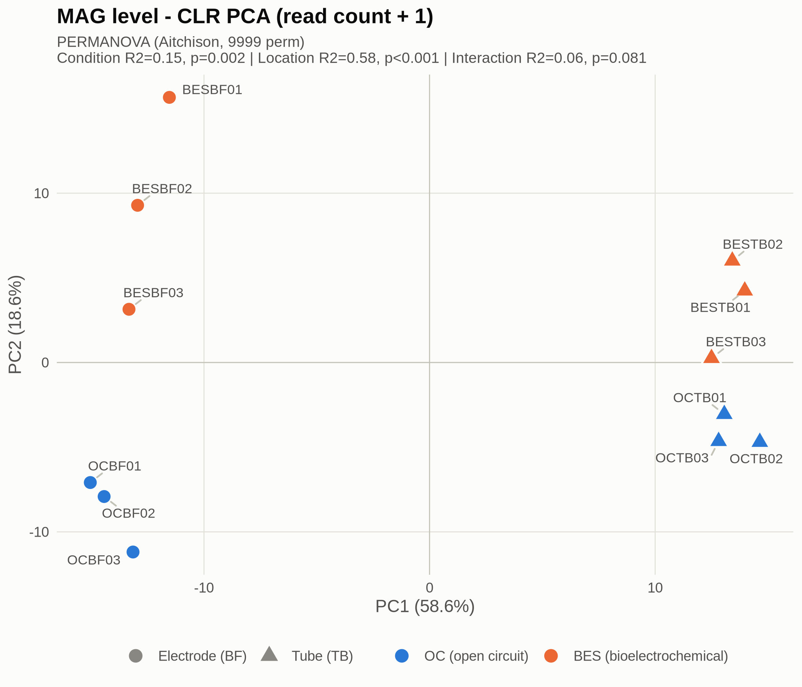
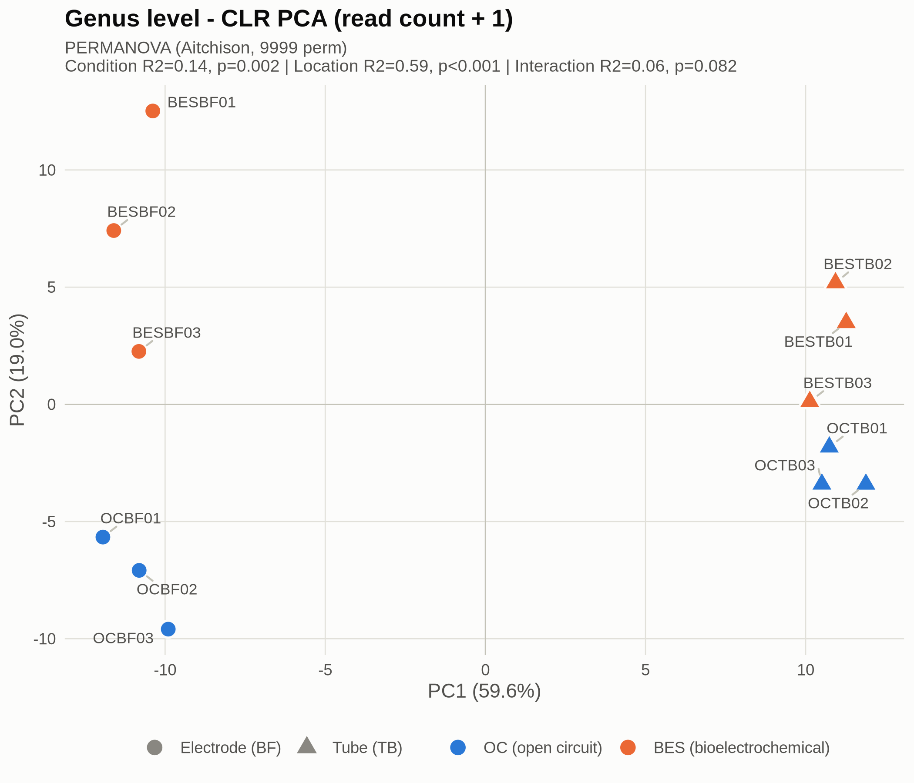
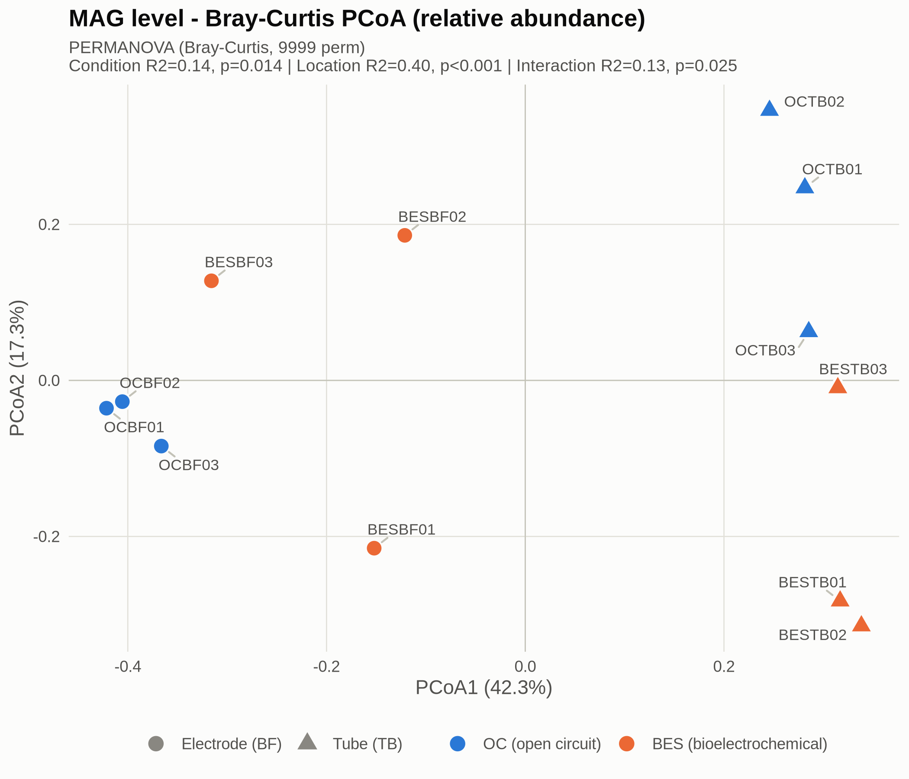
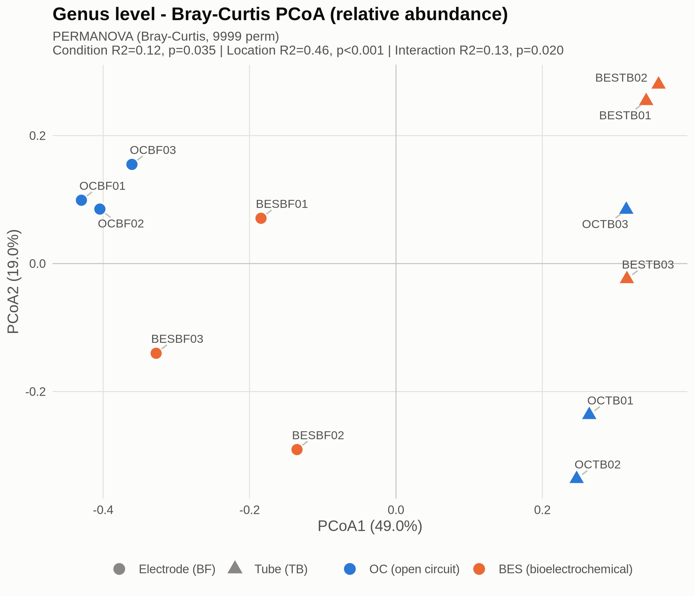
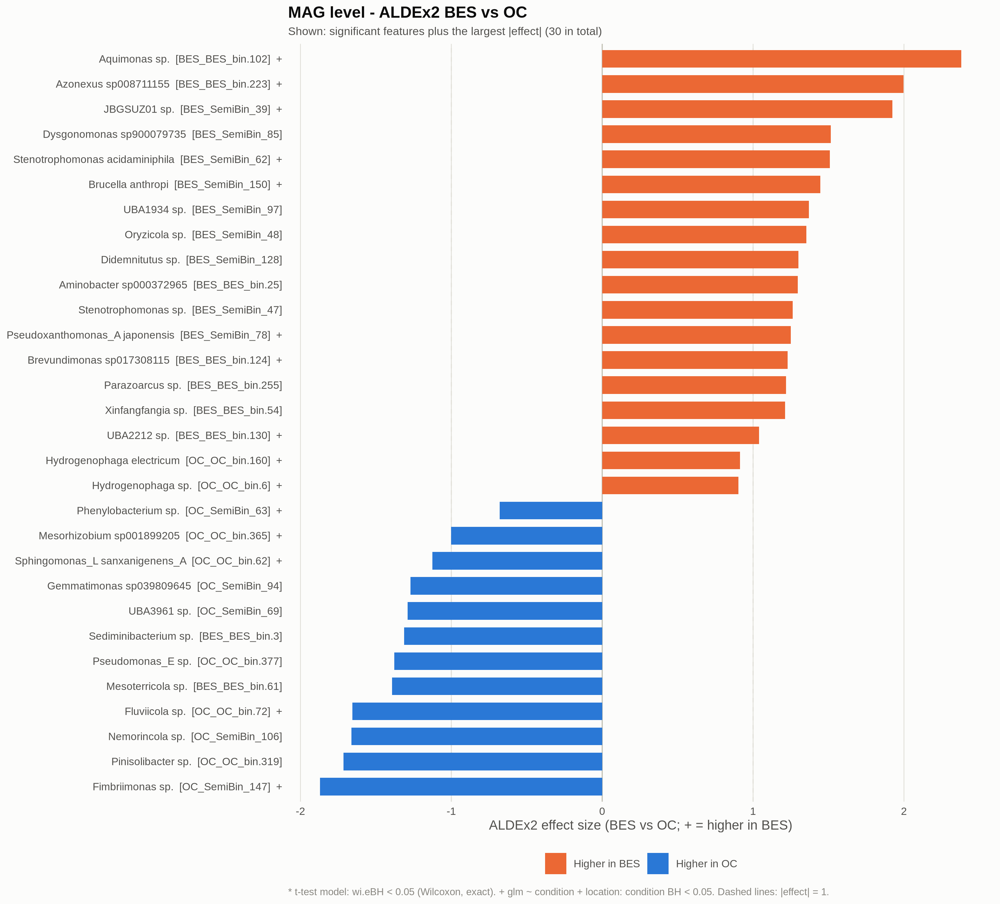
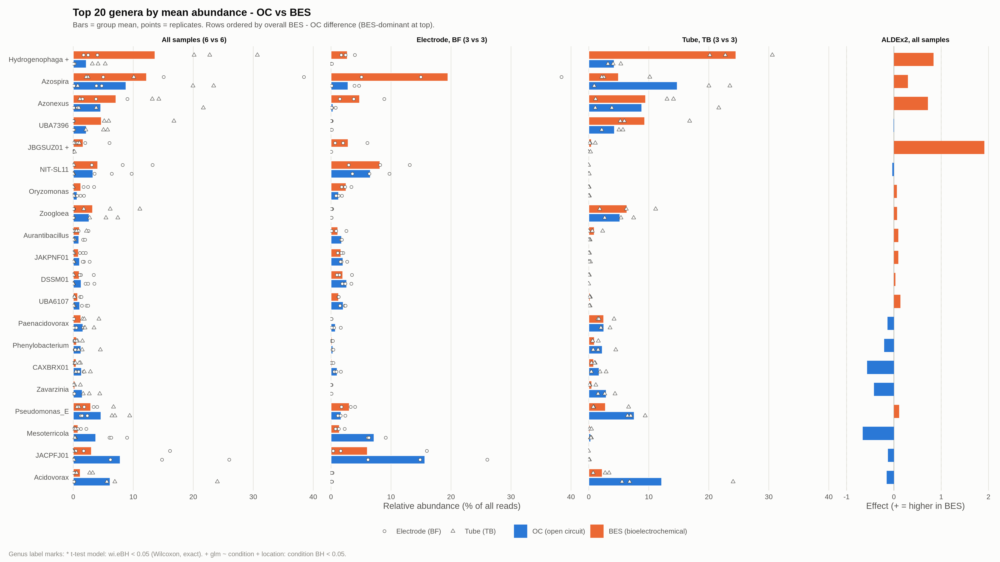

# Se bioelectrochemical metagenome — statistical analysis results

- Design: condition **OC** vs **BES** × location **electrode (BF)** vs **tube (TB)**, 3 replicates per combination (n = 12)
- Quantification: CoverM (276 MAGs), GTDB taxonomy → 186 genus-level labels (13 unclassified labels as `unclassified_<higher taxon>`)
- Reproduce: `Rscript scripts/se_bes_metagenome_stats.R` (seed 20261014, PERMANOVA 9999 perm, ALDEx2 1000 MC)
- Tables in `results/tables/`, figures in `results/figures/` (PDF + PNG)

## Key findings

1. **OC and BES communities differ significantly, with the same conclusion at the MAG and genus level.**
   Bray-Curtis PERMANOVA: condition R² = 0.14 (MAG, p = 0.014) / 0.12 (genus, p = 0.035).
   Also significant with Aitchison distance: R² = 0.15 / 0.14, p = 0.002.
2. **Electrode vs tube (location) is the dominant factor.** R² is 0.40–0.47 (Bray-Curtis) and 0.58–0.59 (Aitchison), about 3–4 times that of condition.
   The condition × location interaction is also significant with Bray-Curtis (R² ≈ 0.13, p ≈ 0.02),
   i.e. the effect of current supply differs between electrode and tube.
3. **The requested ALDEx2 BES vs OC test (t-test model, wi.eBH < 0.05) finds 0 significant MAGs/genera.**
   ALDEx2 1.38's own output reports 4 MAGs / 1 genus as significant, but all of them are caused by a bug in ALDEx2's Wilcoxon p-values (section 4.1).
   - With location adjusted (`aldex.glm`), 15 MAGs / 13 genera show a significant BES effect.
   - 8 genera increased under BES: *Hydrogenophaga*, *Aquimonas*, JBGSUZ01, UBA2212, *Brevundimonas*, *Stenotrophomonas*, *Pseudoxanthomonas_A*, *Brucella*.
4. **Electrode vs tube differences are very large.** 134 MAGs / 89 genera have ALDEx2 wi.eBH < 0.05.
   - Electrode: dominated by anaerobic, electrode-biofilm-type taxa such as Geobacterales (NIT-SL11, *Geobacter*, *Oryzomonas*, JACPFJ01), *Humidesulfovibrio* and Anaerolineaceae.
   - Tube: dominated by *Zoogloea*, *Acidovorax*, *Paenacidovorax* and Patescibacteria UBA7396.

---

## 1. Data processing

| Item | Details |
|---|---|
| Matrices | CoverM `Relative Abundance (%)` (Bray-Curtis and summaries), `Read Count` (CLR and ALDEx2). `unmapped` row removed |
| MAG totals | Sum of MAG relative abundance per sample: 76–89% (the rest is unmapped) → `tables/00_sample_metadata.tsv` |
| Genus aggregation | Abundance and read counts summed per genus label (`rowsum`). 276 MAGs → 186 genera |
| Unclassified | 16 MAGs with `unclassified` genus → 13 labels `unclassified_<family/order/…>` using the deepest classified rank (none dropped) |
| GTDB suffixes | Genera that differ in GTDB (e.g. `Pseudomonas_E` vs `Pseudomonas`) are not merged |
| Zeros | No zero read counts (minimum 270 reads). CLR uses count + 1 |

## 2. Two-way PERMANOVA (`adonis2(dist ~ condition * location, 9999 perm)`)

`tables/01_PERMANOVA_MAG.tsv`, `tables/01_PERMANOVA_genus.tsv`

| Level | Term | Df | R² | F | p |
|---|---|---|---|---|---|
| MAG | condition | 1 | **0.144** | 3.49 | **0.0138** |
| MAG | location | 1 | **0.401** | 9.73 | **≤0.0001** |
| MAG | condition × location | 1 | **0.127** | 3.07 | **0.0255** |
| MAG | residual | 8 | 0.329 | | |
| genus | condition | 1 | **0.116** | 3.25 | **0.0345** |
| genus | location | 1 | **0.465** | 13.06 | **≤0.0001** |
| genus | condition × location | 1 | **0.135** | 3.78 | **0.0202** |
| genus | residual | 8 | 0.285 | | |

The design is balanced, so sequential (by = "terms") and marginal decompositions give the same result.

**Supporting tests**
- **Homogeneity of dispersion (betadisper, `01c`)**: condition p = 0.86 / 0.70, location p = 0.92 / 0.90, four groups p = 0.55 / 0.67 (MAG / genus).
  Dispersion does not differ between groups, so PERMANOVA significance can be read as a shift in community centroids.
- **Sensitivity (`01b`)**:

  | Distance / input | condition R² (p), MAG / genus | location R² | interaction R² (p) |
  |---|---|---|---|
  | Bray-Curtis, re-closed so MAGs = 100% | 0.144 (0.013) / 0.117 (0.034) | 0.40 / 0.46 | 0.127 (0.024) / 0.136 (0.019) |
  | Aitchison (Euclidean on CLR) | 0.148 (0.002) / 0.145 (0.002) | 0.58 / 0.59 | 0.063 (0.081) / 0.060 (0.082) |

  - Re-closing gives the same conclusions, so differences in the unmapped fraction (11–24%) do not drive the result.
  - The interaction weakens with Aitchison (p ≈ 0.08), which is based on log-ratios rather than abundance weights.
    The Bray-Curtis interaction therefore mostly comes from **dominant taxa responding differently by location** (e.g. *Hydrogenophaga*, *Azospira* in section 5).
- **Simple effects (`01d`, exploratory)**:
  - BES vs OC within electrode: R² = 0.46 / 0.47 (MAG / genus).
  - BES vs OC within tube: R² = 0.45 / 0.47.
  - The effect is large in both locations. However, 3 vs 3 has only 10 distinct permutation arrangements, so **the minimum attainable p is 0.1**; these p-values cannot establish significance.

## 3. Ordination

| | MAG | genus |
|---|---|---|
| CLR-PCA |  |  |
| Bray-Curtis PCoA |  |  |

All four in one figure: `figures/03_ordination_panel.pdf`

- **CLR-PCA**: PC1 (MAG 58.6%, genus 59.6%) completely separates electrode from tube.
  PC2 (18.6% / 19.0%) places BES above OC in both locations, i.e. the direction of the BES effect is similar in both locations.
- **Bray-Curtis PCoA**: PCoA1 (42.3% / 49.0%) separates the locations.
  - OC electrode samples (OCBF01–03) cluster tightly.
  - BES electrode samples (BESBF01–03) are spread out, with large replicate variation (e.g. BESBF02 has 38% *Azospira*).
  - In the tube, BES and OC separate along PCoA2.
- MAG-level and genus-level layouts are nearly identical.

## 4. ALDEx2 differential abundance

### 4.1 Correction of ALDEx2 1.38 Wilcoxon p-values

The two-sided Wilcoxon p-values of ALDEx2 1.38 (`wi.ep`, `wi.eBH`) have the following problem:

- The opposite tail is computed as 1 − P(W ≥ w) = P(W < w). For a discrete distribution the correct value is P(W ≤ w).
- As a result, **p-values of features that increase toward the second group (in input order) are underestimated.**
  In 6 vs 6, if the second group is entirely higher, p = 0 (the exact minimum is 2/924 = 0.0022).
- In this dataset OC comes first and BES second in the sample order, so **only BES-increased features** became falsely significant.
  - ALDEx2 original output: 4 MAGs / 1 genus, all BES↑.
  - OC↑ features in the mirror-image situation were not significant.
- The script recomputes both tails from the exact Wilcoxon distribution on the same Monte-Carlo CLR instances that ALDEx2 uses.
  The aggregation (per-direction BH → MC mean → smaller of the two) is the same as in ALDEx2.
  - With a single MC instance, the result matches `stats::wilcox.test`.
  - ALDEx2's original values are kept in the `wi.ep_ALDEx2_raw` and `wi.eBH_ALDEx2_raw` columns.
- Welch t (`we.ep`, `we.eBH`) and effect sizes are not affected.

### 4.2 BES vs OC — requested t-test model (`denom = "all"`, `test = "t"`, `effect = TRUE`)

`tables/04_ALDEx2_{MAG,genus}_BES_vs_OC_{significant,all}.tsv` (sorted by effect, descending; + = higher in BES)

| Level | wi.eBH < 0.05 | we.eBH < 0.05 | \|effect\| ≥ 1 (BES↑ / OC↑) | min wi.eBH |
|---|---|---|---|---|
| MAG (276) | **0** | 1 (*Aquimonas* sp., BES_BES_bin.102) | 38 (21 / 17) | 0.149 |
| genus (186) | **0** | 1 (*Aquimonas*) | 25 (15 / 10) | 0.176 |

Two reasons nothing is significant:

- **Resolution limit**: the minimum p of a 6 vs 6 Wilcoxon test is 0.0022.
  With BH over 276 features, at least 12 completely separated features are needed for any adjusted p to fall below 0.05.
  Only two MAGs are completely separated: *Aquimonas* sp. and *Azonexus* sp008711155.
- **Location not adjusted**: comparing OC vs BES alone puts the location difference (R² 0.4–0.6) into within-group variance, reducing power.

For this small two-factor design it is therefore appropriate to **look at effect sizes together with the location-adjusted glm (section 4.3).**

BES↑ MAGs with large effects (top entries; mean relative abundance OC → BES, %):

| MAG | Taxonomy | effect | we.eBH | OC → BES |
|---|---|---|---|---|
| BES_BES_bin.102 | *Aquimonas* sp. (Xanthomonadaceae) | 2.38 | **0.028** | 0.04 → 1.51 |
| BES_BES_bin.223 | *Azonexus* sp008711155 (Rhodocyclaceae) | 2.00 | 0.059 | 0.25 → 6.39 |
| BES_SemiBin_39 | JBGSUZ01 sp. (Acidaminobacteraceae, Clostridia) | 1.92 | 0.065 | 0.05 → 1.65 |
| BES_SemiBin_85 | *Dysgonomonas* sp900079735 | 1.51 | 0.31 | 0.05 → 0.75 |
| BES_SemiBin_62 | *Stenotrophomonas acidaminiphila* | 1.51 | 0.20 | 0.13 → 0.77 |
| BES_SemiBin_150 | *Brucella anthropi* | 1.45 | 0.26 | 0.011 → 0.024 |

Genus-level figure: `figures/04_genus_ALDEx2_BES_vs_OC_effect.png`

### 4.3 BES effect adjusted for location (`aldex.glm(~ condition + location)`, BH)

`tables/04b_ALDEx2_glm_{MAG,genus}.tsv`. The estimate is a CLR difference; + = higher in BES.
This is an additive model, so it assumes the BES effect is the same in both locations.

| Direction | genus (BH < 0.05, 13) | MAG (BH < 0.05, 15) |
|---|---|---|
| **BES↑** | JBGSUZ01 (5.11), *Aquimonas* (4.50), ***Hydrogenophaga*** (3.45; 2.2 → 13.6%), UBA2212 (3.32), *Brevundimonas* (2.73), *Stenotrophomonas* (2.00), *Pseudoxanthomonas_A* (1.25), *Brucella* (0.89) | JBGSUZ01 sp., *Azonexus* sp008711155, *Aquimonas* sp., *Hydrogenophaga electricum* (OC_OC_bin.160; 0.33 → 5.0%), *Hydrogenophaga* sp. (OC_OC_bin.6; 1.4 → 7.4%), UBA2212 sp., *Brevundimonas* sp017308115, *S. acidaminiphila*, *P. japonensis*, *B. anthropi* |
| **OC↑** | *Fluviicola* (−3.89), *Sediminibacterium* (−2.42), *Sphingomonas_L* (−2.11), *Fimbriimonas* (−1.86), *Mesorhizobium* (−1.21) | *Fluviicola* sp., *Sphingomonas_L sanxanigenens_A*, *Fimbriimonas* sp., *Mesorhizobium* sp001899205, *Phenylobacterium* sp. (OC_SemiBin_63) |

### 4.4 Electrode vs tube (same t-test model; + = higher on the electrode)

`tables/04_ALDEx2_{MAG,genus}_electrode_vs_tube_{significant,all}.tsv`

| Level | wi.eBH < 0.05 (electrode↑ / tube↑) | we.eBH < 0.05 | glm location BH < 0.05 |
|---|---|---|---|
| MAG | **134** (75 / 59), all with \|effect\| ≥ 1 | 126 | 158 |
| genus | **89** (50 / 39), all with \|effect\| ≥ 1 | 83 | 103 |

Representative genera with mean relative abundance ≥ 0.5% (electrode / tube, %):

- **Electrode↑**
  - NIT-SL11 (Geobacteraceae; 7.36 / 0.01)
  - JACPFJ01 (Pseudopelobacteraceae; 10.85 / 0.01)
  - *Oryzomonas* (1.89 / 0.01)
  - *Geobacter* (0.75 / 0.00)
  - DSSM01 (Ignavibacteria; 2.29 / 0.02)
  - UBA6107 (Anaerolineaceae; 1.65 / 0.16)
  - JAKPNF01 (Verrucomicrobiota; 1.83 / 0.09)
  - unclassified_Rectinemataceae (0.67 / 0.00)
  - *Humidesulfovibrio* (MAG 0.55 / 0.01)
- **Tube↑**
  - UBA7396 (Patescibacteria; 0.06 / 6.80)
  - *Acidovorax* (0.11 / 7.20)
  - *Zoogloea* (0.09 / 5.78)
  - *Paenacidovorax* (0.39 / 2.50)
  - *Phenylobacterium* (0.24 / 1.59)
  - *Zavarzinia* (0.06 / 1.71)
  - *Bosea* (0.19 / 0.79)

## 5. Genus-level OC vs BES summary

`tables/05_genus_OC_vs_BES_summary.tsv` contains all 186 genera:
- Means and SDs: overall and per location
- Difference, log2FC, ALDEx2 effect, wi.eBH, we.eBH, glm BH
- Sorted by BES − OC difference, descending

Genera with the largest differences in mean relative abundance (%, OC → BES):

| genus | All OC → BES | Electrode OC → BES | Tube OC → BES | ALDEx2 effect | glm BH |
|---|---|---|---|---|---|
| ***Hydrogenophaga*** | 2.18 → **13.63** | 0.12 → 2.73 | 4.24 → **24.53** | 0.84 | **0.006** |
| *Azospira* | 8.79 → 12.22 | 2.84 → **19.49** | 14.75 → 4.95 | 0.30 | 1.00 |
| *Azonexus* | 4.58 → 7.12 | 0.33 → 4.76 | 8.84 → 9.47 | 0.72 | 0.33 |
| UBA7396 | 2.18 → 4.69 | 0.07 → 0.05 | 4.28 → 9.32 | −0.01 | 1.00 |
| JBGSUZ01 | 0.05 → 1.65 | 0.01 → 2.86 | 0.09 → 0.44 | 1.92 | **0.034** |
| *Aquimonas* | 0.04 → 1.51 | 0.02 → 2.61 | 0.06 → 0.42 | 2.36 | **0.012** |
| *Stenotrophomonas* | 0.24 → 1.09 | 0.18 → 1.17 | 0.30 → 1.00 | 1.38 | **0.034** |
| *Brevundimonas* | 0.06 → 0.77 | 0.01 → 0.28 | 0.11 → 1.26 | 1.09 | **0.012** |
| … | | | | | |
| *Mesoterricola* | 3.75 → 0.79 | 7.17 → 1.40 | 0.33 → 0.18 | −0.66 | 0.11 |
| JACPFJ01 | 7.83 → 3.03 | 15.64 → 6.06 | 0.01 → 0.00 | −0.13 | 0.60 |
| *Acidovorax* | 6.14 → 1.17 | 0.13 → 0.09 | 12.15 → 2.25 | −0.15 | 0.52 |
| *Sediminibacterium* | 0.89 → 0.09 | 1.12 → 0.06 | 0.65 → 0.12 | −1.65 | **0.047** |
| *Fluviicola* | 0.77 → 0.04 | 0.75 → 0.01 | 0.78 → 0.07 | −1.67 | **0.012** |

Per-sample composition (top 8 genera): `figures/05_genus_composition_stacked.png`

---

## 6. Interpretation

### Q1. Are OC and BES communities significantly different? Is the conclusion the same at MAG and genus level?

- **Yes, and the conclusion is the same at both levels.**
  - condition R²: Bray-Curtis 0.14 (MAG) / 0.12 (genus), Aitchison 0.15 / 0.14, all p < 0.05.
  - There is no dispersion difference (betadisper), so this is a centroid shift.
  - The conclusion holds with re-closed data and with Aitchison distance.
- However, the variation explained by condition (12–15%) is about 1/3–1/4 of that explained by location (40–59%).
- The Bray-Curtis interaction (R² ≈ 0.13) means the effect of current supply differs by location.
  CLR-PCA PC2 shows that the direction of the BES effect is similar in both locations;
  the interaction mainly comes from dominant genera changing by different amounts in each location
  (*Hydrogenophaga* +20 pp in the tube; *Azospira* +17 pp on the electrode but −10 pp in the tube).
- Aggregating to genus slightly increases location R² (0.40 → 0.47) and slightly decreases condition R² (0.14 → 0.12),
  because some BES responses are species (MAG) specific (Q4).

### Q2. Which species/genera increased significantly under BES (current supply)?

- **None by the requested criterion (ALDEx2 t-test, wi.eBH < 0.05)**, at either the MAG or the genus level.
- By Welch (we.eBH), one feature is significant: ***Aquimonas* sp. (BES_BES_bin.102)**,
  effect 2.4, relative abundance 0.04 → 1.5%. The genus *Aquimonas* gives the same result.
- **With location adjusted (glm), the following increased consistently under BES** (genus BH < 0.05, with matching MAG-level results):
  - ***Hydrogenophaga*** (2.2 → 13.6%, mostly in the tube)
    - Both MAGs, *H. electricum* and *Hydrogenophaga* sp., are significant.
    - A genus known for hydrogen-oxidizing bacteria. If the electrode reaction produces H₂, this could explain the increase (hypothesis).
  - ***Aquimonas***, **JBGSUZ01** (Clostridia, Acidaminobacteraceae): increased mainly on the electrode.
  - ***Stenotrophomonas*** (*S. acidaminiphila*), ***Pseudoxanthomonas_A*** (*P. japonensis*), ***Brevundimonas***, **UBA2212** (Erysipelotrichaceae)
  - ***Brucella anthropi***: significant, but at only 0.01–0.02% relative abundance.
  - MAG level only: ***Azonexus* sp008711155** (0.25 → 6.4%)
- Decreased under BES (OC↑): *Fluviicola*, *Sediminibacterium*, *Sphingomonas_L*, *Fimbriimonas*, *Mesorhizobium*.
- **Genera with large but non-significant abundance changes**: *Azospira* (+3.4 pp), *Acidovorax* (−5.0 pp), JACPFJ01 (−4.8 pp), *Mesoterricola* (−3.0 pp).
  - Replicate variation is large (*Azospira* BESBF: 5–38%) or the direction is opposite between locations.
  - With n = 3 these should be treated as trends only.
- Some genera such as *Stenotrophomonas* have reported selenite-reducing capacity in the literature.
  Any link to Se metabolism should be checked with functional gene annotation of the corresponding MAGs.

### Q3. What is the difference between electrode and tube?

- **It is the strongest factor in this experiment.**
  - PERMANOVA R² 0.40–0.47 (Bray-Curtis), 0.58–0.59 (Aitchison), p ≤ 0.0001.
  - ALDEx2 significant features: 134/276 MAGs, 89/186 genera.
  - CLR-PCA PC1 (~59%) completely separates the two locations.
- **Electrode**: dominated by taxa commonly reported in anaerobic electrode biofilms, such as Geobacterales (NIT-SL11, *Geobacter*, *Oryzomonas*, JACPFJ01), *Humidesulfovibrio* (Desulfovibrionaceae), Anaerolineaceae (UBA6107) and Ignavibacteria (DSSM01).
  These are **already high on OC electrodes** (NIT-SL11 6.6 → 8.2%, JACPFJ01 15.6 → 6.1%),
  so the electrode surface itself selects for them, and current supply did not increase them further.
- **Tube**: dominated by *Acidovorax*, *Zoogloea*, *Paenacidovorax* (Burkholderiales), Patescibacteria UBA7396, *Phenylobacterium*, *Zavarzinia*, etc.
- The simple-effect R² of BES vs OC within each location is similar (electrode 0.46, tube 0.45)
  and smaller than the location difference (0.68 within OC, 0.55 within BES).
  There is a tendency for the between-location difference to shrink slightly under BES.

### Q4. Do the MAG-level and genus-level results agree?

- **Where they agree**
  - PERMANOVA significance and R² magnitudes, ordination layouts
  - Proportion of location-significant features: 49% of MAGs, 48% of genera
  - All 8 glm BES↑ genera correspond to significant MAGs at the MAG level
- **Where they differ**: aggregating to genus can dilute species-level responses or, conversely, pool signal.
  - *Azonexus*: only sp008711155 of 3 MAGs increased, so it is significant at MAG level but not at genus level (glm BH 0.33).
  - *Phenylobacterium*: only 1 of 6 MAGs is significant (OC↑); the genus is not.
  - *Sediminibacterium*: pooling its 2 MAGs made the genus significant (OC↑).
- **Genus-level results should therefore be read together with MAG-level results**,
  particularly for genera with several MAGs such as *Azonexus*, where species-specific responses can be missed.

## 7. Limitations and next steps

- n = 3 per combination.
  - Simple-effect PERMANOVA cannot give p below 0.1.
  - A 6 vs 6 Wilcoxon test has a minimum p of 0.0022, making significance after multiple testing hard to reach. Effect sizes are therefore reported alongside.
- The ALDEx2 BES vs OC t-test ignores location. The glm is additive and does not model location-specific responses (interaction).
  For location-specific BES effects of particular genera, compare within each location, focusing on effect sizes because it is 3 vs 3.
- The data are relative (compositional), so an increase in one taxon can appear as a relative decrease in others.
  Absolute quantification (e.g. qPCR) would strengthen the interpretation.
- Reads not mapped to MAGs (11–24%) are not included in the analysis.
- Functional interpretations (hydrogen oxidation, Se reduction, etc.) are hypotheses based on taxon names and should be confirmed with MAG functional annotation (e.g. DRAM, KEGG).

## Files

| File | Contents |
|---|---|
| `tables/00_sample_metadata.tsv` | Sample metadata, MAG totals, unmapped % |
| `tables/00_MAG_taxonomy_genus_map.tsv` | MAG → genus label, display name |
| `tables/00_genus_taxonomy.tsv` | Higher taxonomy and member MAGs per genus label |
| `tables/01_PERMANOVA_{MAG,genus}.tsv`, `01_PERMANOVA_MAG_vs_genus.tsv` | Main PERMANOVA |
| `tables/01b_PERMANOVA_sensitivity.tsv` | Re-closed Bray-Curtis, Aitchison |
| `tables/01c_betadisper.tsv` | Homogeneity of dispersion |
| `tables/01d_PERMANOVA_simple_effects.tsv` | Simple effects within location / condition (exploratory) |
| `tables/03_ordination_scores.tsv` | PCA/PCoA coordinates and variance explained |
| `tables/04_ALDEx2_*_{significant,all}.tsv` | ALDEx2 t-test model (BES vs OC, electrode vs tube) |
| `tables/04_ALDEx2_summary.tsv` | Counts of significant features |
| `tables/04b_ALDEx2_glm_{MAG,genus}.tsv` | Location/condition-adjusted glm |
| `tables/05_genus_OC_vs_BES_summary.tsv` | Per-genus OC/BES means (overall and per location), changes, ALDEx2 results |
| `figures/03_*` | Four ordinations and the combined panel |
| `figures/04_*_ALDEx2_BES_vs_OC_effect` | ALDEx2 effect plots |
| `figures/05_genus_OC_vs_BES_barplot`, `05_genus_composition_stacked` | Genus comparison figures |
| `sessionInfo.txt` | R and package versions, parameters |
